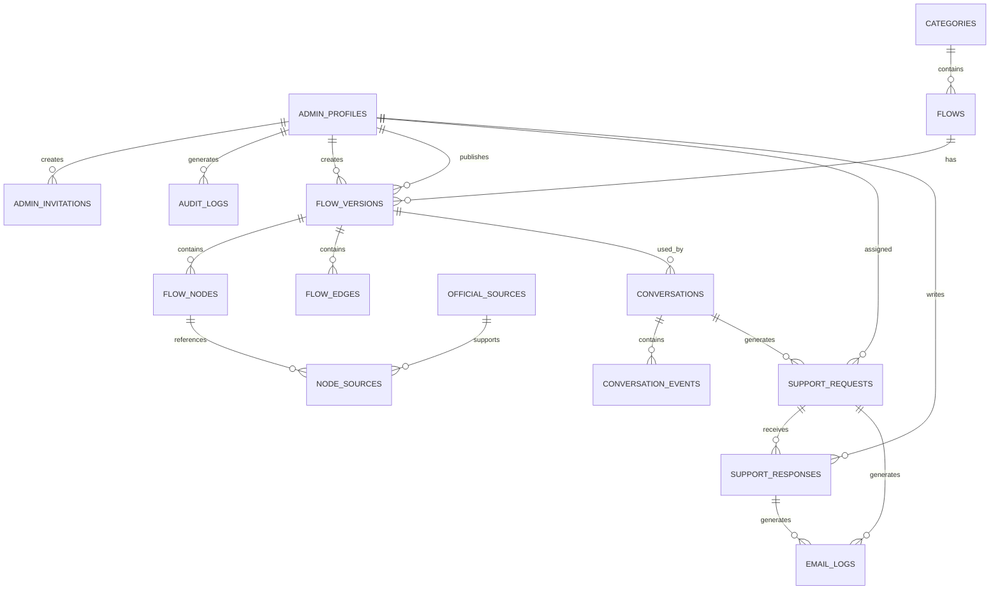
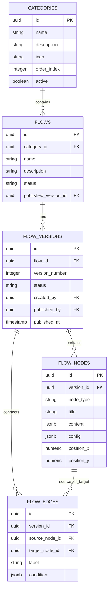
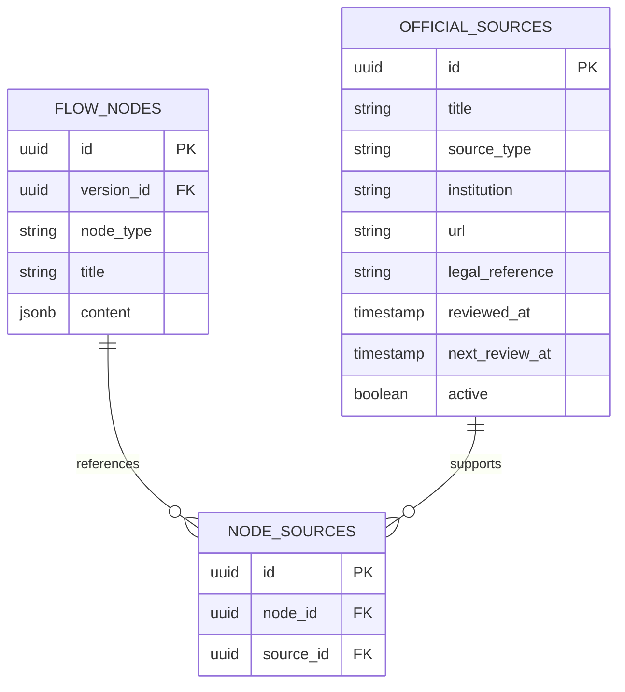
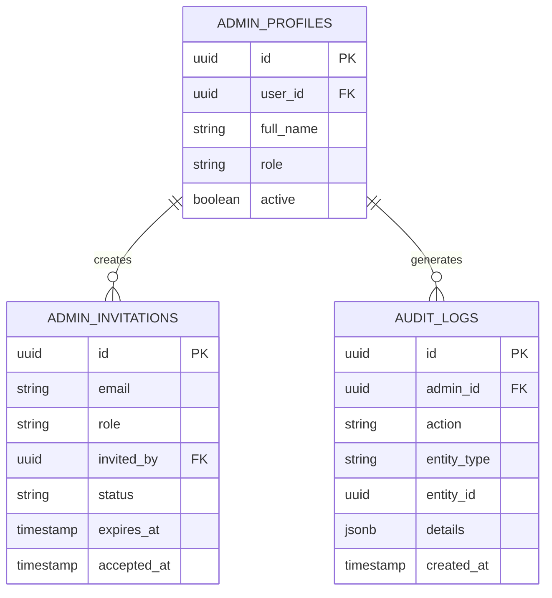
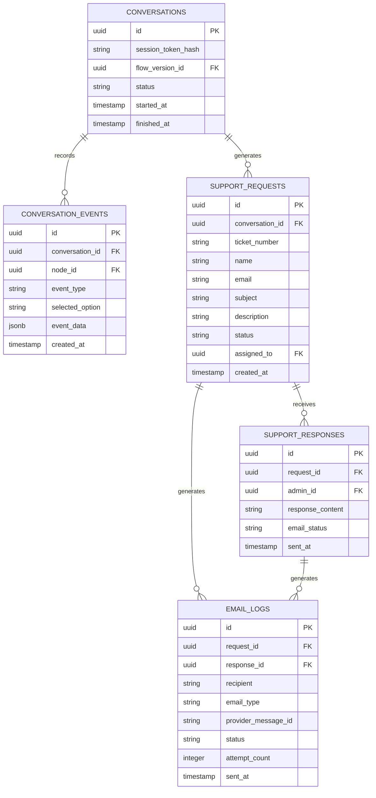

# Diagrama Entidad-Relación – Migrabot

## 1. Introducción

Este documento representa las relaciones entre las entidades principales de la base de datos de Migrabot.

El modelo está diseñado para PostgreSQL mediante Supabase.

Su objetivo es proporcionar una representación visual de las relaciones entre administración, flujos de conversación, fuentes oficiales, conversaciones públicas y solicitudes de atención.

## 2. Diagrama general

## 3. Diagrama del motor de conversaciones

## 4. Diagrama de fuentes oficiales

## 5. Diagrama de administración

## 6. Diagrama de conversaciones y atención

## 7. Reglas de relaciones

### Administración

- Un funcionario puede crear múltiples invitaciones.
- Un funcionario puede generar múltiples registros de auditoría.
- Un funcionario puede crear o publicar múltiples versiones de flujos.
- Un funcionario puede tener asignadas múltiples solicitudes.
- Un funcionario puede redactar múltiples respuestas.

### Motor de conversaciones

- Una categoría puede contener varios flujos.
- Un flujo puede tener varias versiones.
- Una versión contiene múltiples nodos.
- Una versión contiene múltiples conexiones.
- Cada conexión relaciona un nodo de origen con un nodo de destino de la misma versión.

### Fuentes oficiales

- Un nodo puede tener múltiples fuentes.
- Una fuente puede respaldar múltiples nodos.

### Conversaciones

- Una conversación puede contener múltiples eventos.
- Una conversación puede generar una solicitud de atención.
- Una conversación estará asociada a la versión exacta del flujo utilizado.

### Atención personalizada

- Una solicitud tendrá un funcionario responsable.
- Una solicitud puede tener múltiples respuestas.
- Una solicitud puede generar múltiples registros de correo.
- Cada respuesta estará asociada al funcionario que la elaboró.

## 8. Consideraciones técnicas

- Todas las relaciones deberán utilizar claves foráneas.
- Se utilizarán identificadores UUID.
- Las relaciones deberán tener reglas de eliminación controladas.
- Las versiones publicadas serán inmutables.
- Los nodos y conexiones pertenecerán a una versión específica.
- Las políticas RLS deberán respetar las relaciones entre funcionarios y solicitudes.
- Las operaciones públicas deberán ejecutarse mediante funciones controladas.
- Se deberán evitar ciclos inválidos en los flujos.
- Se implementarán índices en las columnas utilizadas frecuentemente.

## 9. Estado del modelo

Modelo entidad-relación conceptual inicial.

Pendiente:

- Validación del modelo físico.
- Definición de cardinalidades y restricciones definitivas.
- Tipos de datos PostgreSQL.
- Claves foráneas.
- Índices.
- Políticas RLS.
- Migraciones SQL.
- Pruebas de integridad.